# Agent Office

A Claude Code mod that turns your subagents into a live pixel-art office.



- **The boss room** is the main chat. Claude sits there with a crown and shows what it's doing ("briefing: implement the cache", "waiting on 3 agents").
- **Every subagent Claude dispatches** walks in through the gate and takes a desk. It gets a job title from its task (Architect, Developer, QA, DevOps, Designer, Reviewer, Researcher, Writer) and a matching desk item.
- **Speech bubbles** show what each agent is doing right now: the file it's editing, the command it's running, or what it just said.
- **Researchers** use the research room. When the engineering desks are full, agents use the meeting room, then queue in the lobby.
- **Finished agents** walk to the lounge with a ✓. The lounge clears when you send your next prompt.
- **The status bar and sprint board** show who's working and on what. Hover over anyone for their full task, step count and time.

## Install

You need Claude Code 2.1.295 or newer (`claude update`). In a terminal Claude Code session, type:

```
/plugin install agent-office --marketplace alimehmetk/agent-office
```

Answer `y` to add the marketplace, then pick the user scope. The office opens as a pane the next time Claude dispatches subagents, and it works in the Claude desktop app's Code tab too.

## Use

- `/office` opens the pane (or reopens it after you close it).
- In the desktop app you get the pixel office. A terminal session shows a text list of agents instead.

## Update or remove

```
claude plugin update agent-office@alimehmetk
claude plugin uninstall agent-office@alimehmetk
```
